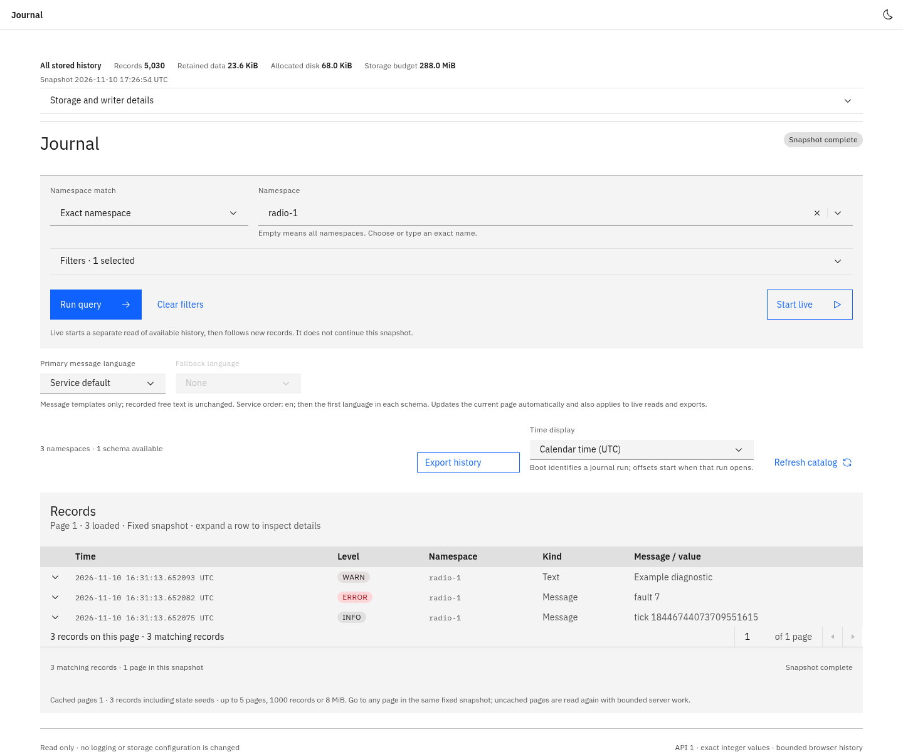
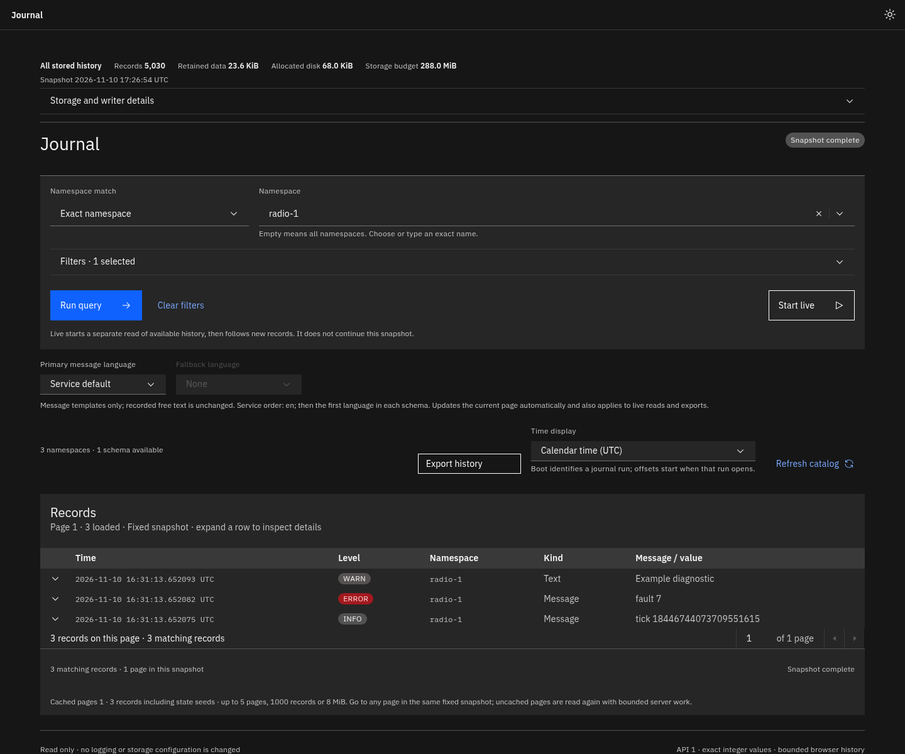

# dduroc

Compact typed event logs and telemetry for embedded Linux, written in Rust.
Store stable IDs, relative timestamps and binary fields; recover message text,
levels, names and units from your compiled schema when reading. Raft Engine
provides the storage journal, with explicit class budgets and namespace quotas.

The workspace targets **0.2.0**. See the [0.2 release notes](https://github.com/dodeca1337/dduroc/blob/v0.2.0/CHANGELOG.md)
for API changes and the storage downgrade boundary.

## Getting started

Requires Rust 1.88 or newer and Linux. The writer is synchronous and uses a
dedicated OS thread; it does not require Tokio. The `read` feature is enabled
by default.

```toml
[dependencies]
dduroc = "0.2.0"
# Writer only:
# dduroc = { version = "0.2.0", default-features = false }
```

```rust
use dduroc::prelude::*;
use dduroc::{NsQuota, StorageClass};

dduroc::schema! {
    name: radio,
    version: 1,
    languages: [en],
    events {
        PowerSet = 1 {
            level: Info,
            store: critical,
            en: "power set to {dbm} dBm",
            dbm: f32,
        },
    }
}

fn main() -> Result<(), Box<dyn std::error::Error>> {
    let root = std::env::args_os().nth(1).ok_or("pass a log directory")?;
    let store = Store::open(StoreConfig::new(root).with_budget_per_class(16 << 20))?;
    let radio = store.namespace_with_quota(
        "radio-0",
        radio::SCHEMA,
        NsQuota::new().limit_bytes(StorageClass::Critical, 1 << 20),
    )?;
    radio.try_log(radio::events::PowerSet { dbm: 27.5 })?;
    // Critical success confirms a synchronous storage write.
    // Ordinary success confirms queue admission; use sync for a barrier.
    store.sync()?;
    Ok(())
}
```

Run the equivalent compiled example from this repository:

```sh
cargo run -p dduroc --example 05_quickstart -- /path/to/journal
```

Use `try_log`, `try_sample` and checked span methods when the caller needs a
verdict. Quiet `log`/`sample` wrappers count failures; they do not provide a
success acknowledgement. Events may be passed by value or by reference.
A span guard carries explicit context and attempts a nonblocking end on drop;
call `close()` when its end needs confirmation.

## Bounded reading

Reuse a reader, choose a query, then keep the owned session while paging.
`PageLimits` validates nonzero per-page dimensions once; `ReadLimits` bounds
cumulative scan/output work, including initialization. Sessions preserve tied
timestamps, the channel roster, schemas, time anchors and block watermarks.
Their handles are local to the running process, not restart tokens.

```rust
use dduroc::prelude::*;
use dduroc::read::{Cancellation, Order, PageLimits, Query, ReadLimits};
use std::sync::Arc;

fn browse(store: &Arc<Store>) -> Result<(), Box<dyn std::error::Error>> {
    let reader = Arc::new(store.reader());
    let pages = PageLimits::new(64, 256 * 1024)?;
    let cancel = Cancellation::new();
    let query = Query::new().namespace("radio-0").order(Order::Oldest);
    let mut session = reader.open_session(query, ReadLimits::default(), cancel.clone())?;
    loop {
        let page = session.next_page(pages)?;
        for entry in &page.entries {
            println!("{:?}", reader.render_preferred(entry));
        }
        // Report page.damaged, page.unanchored and page.truncated to the caller.
        if page.exhausted { break; }
    }
    // Another task may call cancel.cancel() while reading.
    Ok(())
}
```

`open_counted_session(query, limits, cancellation, pages)` returns the session
and exact `QueryTotals` before its first page: matching records, separate state
seeds and pages under both row/byte ceilings. It scans that same frozen
snapshot under the cumulative budgets; incomplete/truncated counts are refused.
`seek_page(target, pages, max_pages)` makes bounded indexed progress, including
backward navigation. Indexed and sequential advancement cannot be mixed.

Cancellation, deadlines, exhausted resources and expired history are explicit
errors. Cancellation cannot interrupt an already-running OS read or application
decoder. Reader limits bound named work dimensions rather than total RSS; a
merged query retains a decoded head block per selected channel. Classic
`query`, `stream` and `follow` convenience APIs keep their documented behavior;
controlled sessions require the current Raft backend. See the compiled
[bounded example](https://github.com/dodeca1337/dduroc/blob/v0.2.0/crates/dduroc/examples/06_bounded_reads.rs).

## Time, languages and statistics

- `Query::since`, `until` and `time_window` accept `chrono::DateTime<Utc>` or
  boot-relative time. Bounds are inclusive. Record a trusted current reading
  with `store.record_sync(Utc::now(), SyncSource::Ntp)` (or the actual source).
  Anchors persist and apply retroactively to that hardware boot. No clock is
  trusted automatically; `Entry::utc` stays `None` without an anchor, and UTC
  filtering reports excluded unanchored runs.
- Configure `reader.with_language_preferences(LanguagePreferences::new(["ru",
  "en"])?)` before sharing. Preferences try each code exactly, then with
  ASCII case/hyphen equivalence; the schema's first language is the final
  fallback. Per-read presentation overrides are independent. Free text is not
  translated; preferred rendering requires a confirmed compiled schema identity.
- `Reader::statistics_controlled` reports retained counts/logical bytes and
  optional allocated-root bytes. `Store::stats()` reports runtime writer
  activity and resets on reopen. Retained totals are distinct from filtered
  query totals. Older roots may require explicit bounded
  `backfill_statistics_step` maintenance before counts become exact.

## GraphQL adapter

```toml
[dependencies]
dduroc-graphql = "0.2.0"
```

`build_schema(Service, SchemaLimits)` returns a transport-neutral `LogSchema`
for `execute`/`execute_stream` or your own HTTP/WebSocket host. Supply an
`Arc<Reader>`, server ceilings and a Tokio runtime with its time driver enabled.
The adapter does not start a listener or let clients choose filesystem paths.

Queries expose catalog, statistics and bounded reads. Mutations open counted or
sequential sessions, seek/advance/cancel/close them and backfill statistics.
`follow` is a bounded live subscription. Session advancement uses revisions;
capabilities expire and cannot resume after process restart. Slow consumers get
an explicit terminal error and must resynchronize.

The schema bounds admission, scanning, projection and response presentation.
Unsigned integers use decimal strings; tagged decoded values preserve nested
maps, variants and floating-point bits. These limits are not exact HTTP-byte
or total-RSS caps. The host owns body/batch limits, authentication and access
control. See the [SDL](https://github.com/dodeca1337/dduroc/blob/v0.2.0/crates/dduroc-graphql/schema.graphql).

```sh
cargo run -p dduroc-graphql --example embedded_schema
cargo run -p dduroc-graphql --example embedded_schema -- --sdl
```

## Embedded web viewer

`dduroc-web` embeds a Svelte/TypeScript viewer using Carbon and provides an
Axum asset router. Your application supplies GraphQL HTTP/WebSocket endpoints,
its own listener and middleware.





```rust
let ui = dduroc_web::mount("/logs", dduroc_web::UiConfig {
    base_path: "/logs/".into(),
    graphql_endpoint: "/graphql".into(),
    subscription_endpoint: Some("/graphql/ws".into()),
    ..Default::default()
})?;
let app = app.merge(ui);
```

The viewer includes namespace autocomplete, exact filtered totals with native
Carbon pagination, UTC/boot time display, message language/fallback preferences,
retained storage statistics, light/dark themes and bounded CSV/JSONL downloads.
Exports use a separate query with editable filters/time range and explicit
partial-result handling. The same assets display new compiled schemas without
a frontend rebuild. Fonts are local; runtime analytics are absent.

Ordinary `cargo build -p dduroc-web` embeds and verifies the shipped assets
without invoking Node/npm. To rebuild from the included sources:

```sh
cargo build -p dduroc-web --features build-ui
# Also require identical source/asset hashes to the shipped manifest:
DDUROC_VERIFY_PREBUILT=1 cargo build -p dduroc-web --features build-ui
```

Source builds require Node 22.12 or newer and npm. Locked dependencies install
with lifecycle scripts, audit/funding requests and Carbon/IBM telemetry
disabled. Build scratch, npm cache and dependencies are removed afterward.
Hashes make inputs/outputs inspectable; they do not replace dependency review.
The [Carbon opt-out](https://www.carbondesignsystem.com/support/faqs) and
[IBM opt-out](https://github.com/ibm-telemetry/telemetry-js#opting-out-of-ibm-telemetry-data-collection)
mechanisms are applied by the build commands.

```sh
cargo run -p dduroc-web --example server
```

This example is the standalone host. For frontend maintenance, use
`npm ci --ignore-scripts --no-audit --no-fund` in `crates/dduroc-web/ui`, then
`npm run dev`, `npm run check` and `npm test`. Refresh shipped assets with
`node crates/dduroc-web/update-dist.mjs` from the workspace; it copies the real
Cargo source-build output and manifest without staging files.

## Durability, resources and compatibility

Critical success waits for a synchronous nonempty backend write. Ordinary
records synchronize periodically (10 seconds by default) or through explicit
`Store::sync()`. An error does not prove absence after restart: unconfirmed
writes can survive, so retries are not automatically exactly-once. Hardware and
filesystems must honor sync. Process-crash and injected-error tests do not
establish physical eMMC/SD power-cut safety.

Class budgets are shared across namespaces; personal quotas apply within them.
Retention deliberately expires old records, including critical records. Queue
slots, queue-owned payload bytes, active writer buffers and reader work have
separate limits. Logical bytes differ from allocated disk usage; physical-root
limits are admission ceilings with GC working headroom, not filesystem capacity
or a proven hard cap on transient upstream rewrite allocation. Configure a
resource profile for your device; [example 07](https://github.com/dodeca1337/dduroc/blob/v0.2.0/crates/dduroc/examples/07_small_resource_profile.rs)
is illustrative, not measured board sizing.

The 0.2 writer upgrades recognized Raft roots to store-metadata writer version
3 and a new marker content. Block codec version 2 is unchanged. New readers
accept old roots; 0.1 readers/writers refuse upgraded roots. Preserve a copy
before upgrading if a downgrade may be needed. Do not edit markers manually.
Legacy segment stores require explicit offline export/import into a new root.

Normal Raft recovery is strict and may refuse a corrupt/torn tail. Optional
copy-only recovery keeps source and unopened evidence separate from a candidate;
explicit tolerant candidate repair reports possible loss and never activates it:

```sh
cargo run -p dduroc-engine --features recovery --example recover_copy -- SOURCE NEW_DEST
```

Supply every original custom root, stop writers first and budget two copies plus
engine working space. Failure does not establish preservation of every external
critical acknowledgement. See the [design](https://github.com/dodeca1337/dduroc/blob/v0.2.0/DESIGN.md)
for recovery, limits, language matching and session contracts.

## Workspace and examples

| Crate | Purpose |
|---|---|
| `dduroc` | Application facade, schema macro and optional reader |
| `dduroc-engine` | Writer, storage, durability, namespaces and retention |
| `dduroc-format` | Compact record/block codec and legacy container codec |
| `dduroc-read` | Queries, stream merging, decoding and time resolution |
| `dduroc-macros` | Compile-time schema declaration |
| `dduroc-graphql` | Bounded GraphQL schema, sessions and subscriptions |
| `dduroc-web` | Embedded Carbon viewer and Axum asset router |

Compiled facade examples cover device writes (01), viewer reads (02), schema
migration (03), operations (04), quickstart (05), bounded reading (06) and a small
resource profile (07). Read examples require the `read` feature. Further details:
[format specification](https://github.com/dodeca1337/dduroc/blob/v0.2.0/SPEC.md),
[measurements and verification boundaries](https://github.com/dodeca1337/dduroc/blob/v0.2.0/BENCHMARKS.md),
[Rust API](https://docs.rs/dduroc/0.2.0/dduroc/).

## License

Licensed under either Apache License 2.0 or MIT, at your option.
